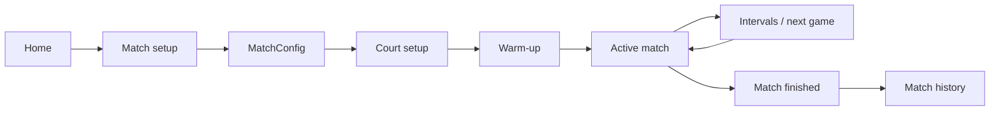

# Badminton Umpire

Badminton Umpire is a Flutter application designed to assist an umpire during a badminton match. It centralizes match setup, on-court configuration, scoring, service/receiver tracking, intervals, announcements, shuttle tracking, match history, and recovery of an interrupted match.

This repository currently represents the **umpire-side application** of a larger badminton tournament management system. The long-term architecture is expected to let an administration/backend system assign a match to a court, after which the umpire completes the on-court setup and runs the match from the tablet or phone.

## Main features

- Singles and doubles match setup.
- Administrative match information: tournament, court, category, umpire, optional service judge, phase and pool information.
- On-court setup before warm-up: side assignment, initial server and receiver.
- Responsive badminton court visualization.
- Two-minute warm-up with countdown and haptic warnings.
- Best-of-three match management using the configured 15-point rules.
- Automatic service and receiving position management.
- Mid-game and between-game intervals.
- Change of ends, including the deciding-game change at 8 points.
- Set point and match point indicators.
- Undo based on match snapshots.
- Match events and disciplinary actions.
- Shuttle counter.
- Optional umpire announcements.
- French and English localization.
- Local current-match recovery and match history.
- Player color customization during the match.

## Project structure

```text
lib/
├── app/                    # MaterialApp and theme
├── core/                   # Shared responsive, settings, haptics and utilities
├── features/
│   ├── home/
│   ├── history/
│   ├── match/
│   │   ├── application/    # Match orchestration / controller
│   │   ├── data/           # Local persistence
│   │   ├── domain/         # Match models and badminton rules
│   │   └── presentation/   # Match UI
│   ├── match_setup/        # Administrative and on-court setup
│   └── settings/
├── l10n/                   # ARB translations and generated localization files
└── main.dart
```

See [Architecture](docs/architecture.md) for the detailed responsibilities of each layer.

## Match flow



The current application manually creates `MatchConfig`. In the future, this configuration can be supplied by the tournament backend while keeping the on-court and match-running flow unchanged.

## Documentation

- [Architecture](docs/architecture.md)
- [Match engine](docs/match-engine.md)
- [Match flow](docs/match-flow.md)
- [Data models](docs/data-models.md)
- [Persistence and recovery](docs/persistence.md)
- [Localization and settings](docs/localization.md)
- [Development guide](docs/development.md)
- [Code documentation conventions](docs/code-documentation.md)

## Development commands

From the Flutter project root:

```bash
flutter pub get
flutter gen-l10n
dart format .
flutter analyze
flutter test
flutter run
```

`dart format .` and `flutter analyze` should be run before committing changes.

## Current architectural direction

The application deliberately keeps match rules inside `MatchController` rather than inside presentation widgets. The UI reads state and sends user actions to the controller. Persistent data is serialized through dedicated models and services.

The next major architectural step should be to use stable player identifiers instead of player names as technical identifiers before connecting the application to a backend.
