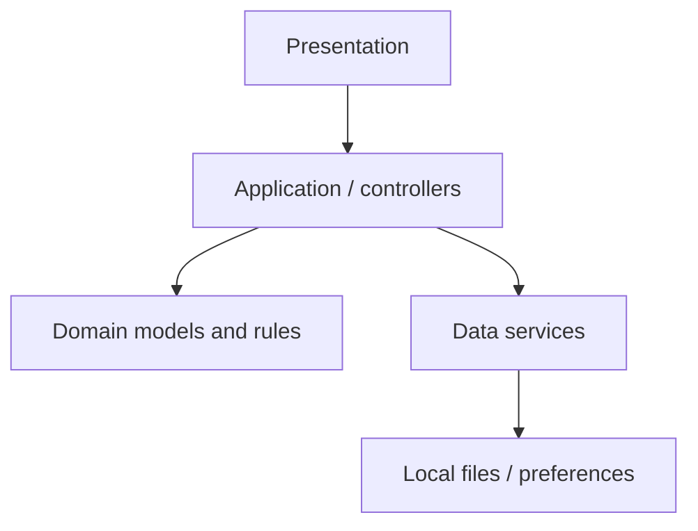
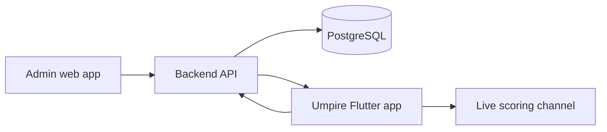

# Architecture

## Overview

The application uses a feature-oriented Flutter structure. Each major feature owns its models, persistence code, application logic and UI where appropriate.



The goal is to keep badminton rules independent from individual widgets and to prevent persistence details from spreading through the UI.

## `app/`

`app.dart` creates the root `MaterialApp`, installs localization delegates and reacts to `AppSettingsController`. The application also clamps text scaling to a supported range to protect the landscape match interface from extreme layout changes.

`theme.dart` owns application-level Material theming.

## `core/`

`core` contains code shared by multiple features:

- `responsive/`: responsive dimensions and breakpoints.
- `settings/`: global application settings and persistence.
- `utils/app_haptics.dart`: reusable haptic feedback patterns.
- `utils/formatters.dart`: shared formatting helpers.
- `widgets/`: generic reusable UI components.

Feature-specific badminton behavior should not be moved into `core` merely to make it reusable.

## `features/match/domain/`

This layer contains the main match data structures and rules.

Important models include:

- `MatchConfig`: fixed administrative configuration of a match.
- `MatchDraft`: serializable state required to resume an interrupted match.
- `MatchSnapshot`: state captured for undo.
- `MatchEvent`: recorded match events.
- `TeamCourtState`: the players and their current physical positions.
- `MatchPhase`: the current state of the match state machine.
- `BadmintonRules`: centralized scoring and interval constants.

## `features/match/application/`

`MatchController` is the central state owner for an active match. It extends `ChangeNotifier` so presentation code can react to changes.

The controller is split into Dart `part` files by responsibility:

```text
match_controller.dart
├── match_controller_scoring.dart
├── match_controller_positions.dart
├── match_controller_intervals.dart
├── match_controller_events.dart
└── match_controller_history.dart
```

This is one logical controller rather than five independent services. Private members remain accessible across the parts while the code stays easier to navigate.

### Controller responsibilities

The controller owns:

- current scores and games won;
- serving team, server and receiver;
- physical left/right team assignment;
- doubles player positions;
- scoring transitions;
- interval phases and deadlines;
- change of ends;
- undo snapshots;
- match events;
- completion state.

The controller should **not** own dialog presentation, navigation, localized text, screen orientation or visual styling.

## `features/match/data/`

The current data layer uses local JSON files.

`MatchDraftService` persists one recoverable current match in `current_match.json`.

`MatchHistoryService` persists completed matches in `match_history.json` and keeps at most 100 entries.

These services hide file-system details from the UI.

## `features/match/presentation/`

`MatchPage` coordinates the active-match screen, timers that are specific to presentation (for example warm-up refresh), persistence calls and navigation.

The page itself is partially split into `part` files for actions, draft handling, history and navigation. Reusable visual concepts are normal widgets under `presentation/widgets/`.

Examples include:

- badminton court and player cards;
- countdown and interval banners;
- control panel and point buttons;
- umpire dialogs;
- next-game and finished overlays.

## `features/match_setup/`

Match setup is intentionally separated into two concepts.

### Administrative setup

`MatchSetupPage` collects information that describes the scheduled match and produces a `MatchConfig`.

### On-court setup

`CourtSetupPage` handles decisions made at the court before warm-up, such as initial sides, server and receiver. This separation is important for the future tournament backend: administrative data can eventually arrive from the server while the umpire still performs the on-court setup locally.

`CourtSetup` exists as a domain model and should become the single object passed from court setup to the active match instead of passing several related primitive parameters independently.

## `features/history/`

The history feature owns completed-match storage models and screens. It is separate from the active-match controller because history is long-lived data, not active scoring state.

## `features/settings/`

`AppSettingsController` is a global `ChangeNotifier`. It currently exposes:

- selected language;
- whether umpire announcement prompts are displayed.

`AppSettingsService` persists those values with `SharedPreferences`.

## Dependency direction

Preferred dependency direction:

```text
presentation -> application -> domain
presentation -> domain
application  -> data
```

Avoid importing presentation widgets into domain or application code.

## Future backend boundary

The intended future architecture is:



The Flutter app should communicate with the backend API rather than directly with PostgreSQL.
