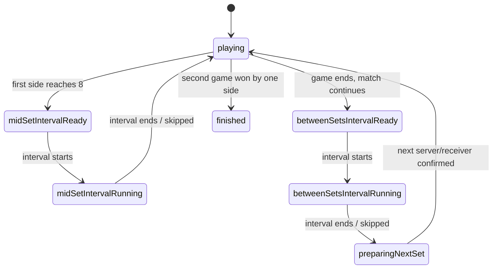

# Match Engine

## Purpose

The match engine is implemented primarily by `MatchController` and `BadmintonRules`. Its purpose is to make scoring behavior deterministic and independent from the UI.

## Configured scoring rules

The current `BadmintonRules` configuration is:

| Rule | Value |
|---|---:|
| Points required to win a game | 15 |
| Required lead | 2 |
| Maximum score | 21 |
| Mid-game interval | first side reaching 8 |
| Games required to win the match | 2 |
| Mid-game interval duration | 60 seconds |
| Between-game interval duration | 120 seconds |
| Interval warning threshold | 20 seconds |

A game is therefore won when a side reaches at least 15 with a two-point lead, or when it reaches 21.

## Match phases

`MatchPhase` acts as a small state machine:



Controls are locked whenever the phase is not `playing`.

## Adding a point

The scoring sequence is conceptually:

1. Reject the action if the match is not in `playing` phase.
2. Save an undo snapshot.
3. Increment the winning side's score.
4. Update service and player positions.
5. Check whether the game has ended.
6. Otherwise check whether the mid-game interval has been reached.
7. Notify listeners.

This ordering matters because undo must restore the complete state that existed before the point.

## Service behavior

If the serving side wins the rally, it keeps service. In doubles, the serving pair swaps its internal top/bottom positions and the receiver is recalculated diagonally from the server.

If the receiving side wins the rally, service transfers to that side. The controller determines which player occupies the required service position and recalculates the diagonal receiver.

## Singles positioning

For singles, the controller derives the displayed top/bottom position from:

- the serving side;
- which team is physically on the left;
- the serving side's score parity.

The visual position is derived rather than stored as an independent mutable singles position.

## Doubles positioning

`TeamCourtState` stores `topPlayer` and `bottomPlayer` for doubles. The initial server and receiver are placed according to the serving side and physical court side. Subsequent rally results update these positions through the controller.

## Mid-game interval

The interval is triggered once per game when the winning rally makes a side reach `BadmintonRules.midSetIntervalScore` (currently 8).

During the deciding third game (`previousSets.length == 2`), the teams also change ends when the interval is triggered. The score and current service state are not reset by this change of ends.

## End of game

When a game finishes:

- the canonical Team A / Team B score is appended to `previousSets`;
- the winning side receives one game;
- if that side has won two games, the match enters `finished`;
- otherwise the teams change ends;
- scores reset to 0-0;
- the mid-game interval flag resets;
- the match enters the between-game interval flow.

`previousSets` remains stored in Team A / Team B order. Presentation code can map it to physical left/right sides when necessary.

## Next-game setup

After the between-game interval, the phase becomes `preparingNextSet`. The winner of the previous game provides the server candidates and the opposite side provides receiver candidates.

`startNextSet()` validates both selected players, updates the serving side, places the initial server and receiver and returns the phase to `playing`.

## Set point and match point

The controller predicts whether the serving side would win the current game on the next rally. Match point is a set point for a side that has already won one game.

These are derived properties; they do not need to be persisted separately.

## Undo

Before score-changing actions, the controller stores a `MatchSnapshot`. Undo restores previous match state rather than trying to mathematically reverse every rule transition.

This approach is safer because one rally can affect several values simultaneously: score, serving side, server, receiver, doubles positions, interval state and match completion.

## Interval timers

Intervals use an absolute `intervalEndsAt` timestamp as the source of truth. `Timer.periodic` refreshes the UI, but remaining time is recalculated from the deadline:

```text
remaining = intervalEndsAt - current time
```

This is more robust than decrementing a counter once per timer tick and allows an interval to be restored after the application is interrupted.

## Recommended tests

The match engine should have unit tests for at least:

- 15-14 does not end a game;
- 16-14 ends a game;
- 21 ends a game at the cap;
- interval occurs once at 8;
- third-game interval changes ends;
- game completion changes ends;
- match ends after two games won;
- service transfer after receiver wins;
- doubles serving-side rotation;
- next-game server/receiver validation;
- undo across normal points, intervals and match completion.
