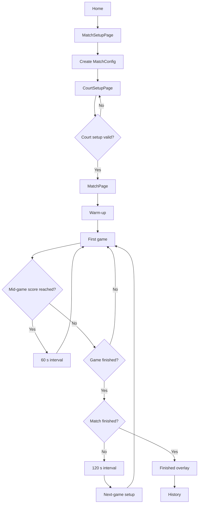
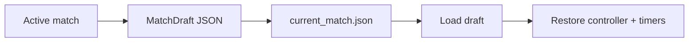
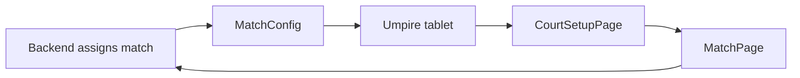

# Match Flow

## Current user flow

## 1. Administrative match setup

`MatchSetupPage` collects the fixed information required to describe the match. Required validation currently includes player names, court number and umpire name. Doubles requires two distinct player names within each pair.

The page creates a `MatchConfig` and navigates to `CourtSetupPage`.

## 2. Court setup

`CourtSetupPage` is the umpire's final pre-match configuration screen. It currently manages:

- which team is on the left;
- initial server;
- initial receiver;
- visual preview of initial positions.

Singles selection is assisted: selecting one server determines the receiver on the opposite team, and selecting the receiver determines the server. Doubles remains freely editable, while the final configuration requires server and receiver to belong to opposite teams.

The intended extension is to also own the initial player colors and package all of these decisions into `CourtSetup`.

## 3. Warm-up

Starting from court setup opens `MatchPage`. With `autoStartWarmup`, the warm-up begins immediately rather than requiring a second start action.

The warm-up uses an absolute end timestamp so its remaining duration can be restored. Haptic feedback is used near completion. The umpire can skip the warm-up.

If umpire announcements are enabled, the first-game announcement is displayed before live scoring begins. If announcements are disabled, the application continues without blocking the match flow.

## 4. Active game

During `MatchPhase.playing`, the umpire can record rallies and other supported actions. `MatchController` updates score, service and positions and notifies the UI.

The UI should not reproduce badminton scoring logic independently.

## 5. Mid-game interval

The first side to reach 8 triggers a ready interval. The umpire can start the 60-second countdown. At 20 seconds remaining, the application can provide the configured warning behavior.

In the deciding game, the change of ends is performed when this interval is triggered.

## 6. Between games

If the match has not ended, completing a game changes ends and starts the between-game flow. After the 120-second interval, the umpire confirms the server and receiver for the next game.

## 7. Match completion

When either side wins two games, the phase becomes `finished`. The completed result is stored in history. The finished overlay provides the final result and match actions.

Undo remains important around completion: if the final rally is undone, the corresponding finished-history state must remain consistent with the active match.

## 8. Recovery flow

The active match is periodically persisted as `MatchDraft`. When the application starts or returns to the match, the draft can recreate the controller and restore wall-clock timers.

## Future tournament flow

The current manual setup page is intentionally replaceable.

This allows the tournament administration system to own scheduling and match metadata while the umpire app remains responsible for on-court decisions and scoring.
