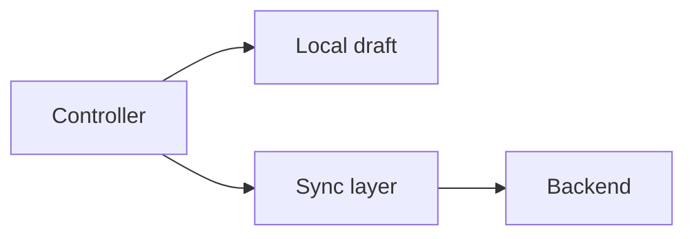

# Persistence and Recovery

## Overview

The application currently uses local device persistence for three different concerns:

- current active match recovery;
- completed match history;
- global application settings.

These responsibilities are intentionally separated.

## Current match draft

`MatchDraftService` stores one active match in:

```text
current_match.json
```

The file is located in the application documents directory obtained through `path_provider`.

### Operations

`MatchDraftService` supports:

- `save(MatchDraft)`;
- `load()`;
- `exists()`;
- `clear()`.

Loading is defensive: missing, empty, invalid or unreadable content results in `null` instead of crashing the application.

## Draft contents

The draft contains enough state to reconstruct an interrupted match, including scores, sets, positions, phase, events, undo history, warm-up state, shuttle count and colors.

`MatchConfig` is serialized inside the draft as of draft version 2.

## Draft migration

`MatchDraft.fromJson` supports both:

```text
Version 2
MatchDraft
└── config
    └── fixed match information
```

and the previous layout where fixed match fields were directly stored in the draft JSON.

This is a useful migration pattern: new application versions can evolve persisted structures without immediately making existing local data unreadable.

## Timer recovery

Countdown state should not rely on the number of successful `Timer.periodic` callbacks.

For intervals, the source of truth is an absolute deadline:

```text
intervalEndsAt
```

Remaining time is recalculated from the current wall clock. If the deadline has already passed when the match is restored, the interval is completed rather than restarted.

Warm-up follows the same conceptual approach with `warmupEndsAt`.

This is important on mobile devices because the operating system can pause or throttle timers when an application is backgrounded.

## Match history

`MatchHistoryService` stores completed matches in:

```text
match_history.json
```

The service:

- loads all history entries;
- inserts newly completed matches at the beginning;
- limits history to 100 matches;
- deletes one or multiple entries;
- clears all history.

The JSON is written with indentation for easier manual inspection.

## Settings persistence

Application-wide preferences are stored separately using `SharedPreferences` through `AppSettingsService`.

These settings are not match-specific and therefore should not be copied into `MatchDraft`.

Examples include language and whether umpire announcement prompts are displayed.

## Persistence responsibilities

A useful rule is:

```text
MatchConfig        fixed information about one match
CourtSetup         pre-match on-court decisions
MatchController    live in-memory state
MatchDraft         recoverable active-match serialization
MatchHistoryEntry  completed-match record
AppSettings        global user preferences
```

Keeping these concepts separate prevents a single model from becoming responsible for every kind of state.

## Future backend synchronization

When a backend is introduced, local persistence should remain useful for resilience. A possible model is:



Local recovery can protect an umpire from temporary connectivity loss while the backend remains the shared tournament source of truth.

Conflict and synchronization rules should be designed explicitly before live remote scoring is introduced.
