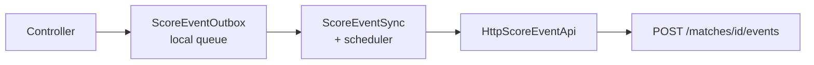

# Persistence and Recovery

## Overview

The application currently uses local device persistence for three different concerns:

- current active match recovery;
- completed match history;
- global application settings.

These responsibilities are intentionally separated.

## Current match draft

`MatchDraftService` stores one active match in:

```text
current_match.json
```

The file is located in the application documents directory obtained through `path_provider`.

### Operations

`MatchDraftService` supports:

- `save(MatchDraft)`;
- `load()`;
- `exists()`;
- `clear()`.

Loading is defensive: missing, empty, invalid or unreadable content results in `null` instead of crashing the application.

## Draft contents

The draft contains enough state to reconstruct an interrupted match, including scores, sets, positions, phase, events, undo history, warm-up state, shuttle count and colors.

`MatchConfig` is serialized inside the draft as of draft version 2.

## Draft migration

`MatchDraft.fromJson` supports both:

```text
Version 2
MatchDraft
└── config
    └── fixed match information
```

and the previous layout where fixed match fields were directly stored in the draft JSON.

This is a useful migration pattern: new application versions can evolve persisted structures without immediately making existing local data unreadable.

## Timer recovery

Countdown state should not rely on the number of successful `Timer.periodic` callbacks.

For intervals, the source of truth is an absolute deadline:

```text
intervalEndsAt
```

Remaining time is recalculated from the current wall clock. If the deadline has already passed when the match is restored, the interval is completed rather than restarted.

Warm-up follows the same conceptual approach with `warmupEndsAt`.

This is important on mobile devices because the operating system can pause or throttle timers when an application is backgrounded.

## Match history

`MatchHistoryService` stores completed matches in:

```text
match_history.json
```

The service:

- loads all history entries;
- inserts newly completed matches at the beginning;
- limits history to 100 matches;
- deletes one or multiple entries;
- clears all history.

The JSON is written with indentation for easier manual inspection.

## Settings persistence

Application-wide preferences are stored separately using `SharedPreferences` through `AppSettingsService`.

These settings are not match-specific and therefore should not be copied into `MatchDraft`.

Examples include language and whether umpire announcement prompts are displayed.

## Persistence responsibilities

A useful rule is:

```text
MatchConfig        fixed information about one match
CourtSetup         pre-match on-court decisions
MatchController    live in-memory state
MatchDraft         recoverable active-match serialization
MatchHistoryEntry  completed-match record
AppSettings        global user preferences
```

Keeping these concepts separate prevents a single model from becoming responsible for every kind of state.

## Score events and backend synchronization

Each point and undo is also a score event (`ScoreEvent`): an id generated on the tablet, a sequence from 1 and the time it was entered. The rules are those of `sendScoreEvents` in `contracts/openapi.yaml`.



- `ScoreEventOutbox` keeps the events the backend has not confirmed yet, per match, in their own file. An event leaves it only once its id comes back in `acceptedIds` or `duplicateIds`.
- `ScoreEventSync` sends them in sequence order, in batches of 100; `ScoreEventSyncScheduler` tries again after 2 s, 5 s, 15 s, 30 s, then every 60 s while the backend cannot be reached.
- `HttpScoreEventApi` is the HTTP client: it sends the tablet token and turns every answer into a result. No answer, a timeout, 408, 429 or 5xx means "try again later"; `SEQUENCE_GAP` gives the sequence to send again from; any other refusal (`TABLET_REVOKED`, `MATCH_NOT_IN_PROGRESS`, `SEQUENCE_ALREADY_USED`...) blocks the match until someone looks at it.
- The backend ignores an event it already received, so sending again after a lost answer or a crash never counts a point twice.

The match page does not send anything yet (`_scoreSync` stays null and the indicator is hidden): the tablet token comes from pairing (below), but the match still needs its backend id (#101, #105). The events wait in the queue meanwhile.

## Tablet pairing

The umpire pairs the tablet with a court by typing the one-time code shown by the organizer (`POST /tablets/pair`). The server answers with a tablet token, valid until the organizer revokes the tablet.

- `TabletSessionController` (`tabletSessionController` for the whole app) holds the pairing: `loading`, `unpaired`, `paired` or `revoked`.
- `SecureTabletSessionStore` keeps the session (API address, token, tablet and court) in the encrypted storage of the device (`flutter_secure_storage`: Android Keystore, iOS Keychain), since the token is a credential. Unreadable data counts as not paired.
- At startup, `main.dart` loads the saved session without the network, so the tablet works offline at once, then checks it with `GET /tablets/me` in the background. Only a **401** (`TABLET_REVOKED`, or an unknown token) ends the session; no answer keeps it. The court number follows the server.
- The API address comes from `--dart-define=API_URL=...` at build time and can be changed on the pairing page; `/api` is added when missing.
- Android allows plain HTTP (`usesCleartextTraffic`), as the API is often served on the local network of the venue.

