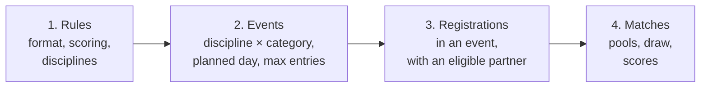

# Competition Rules

How a FenuaSmash tournament works: the rules set by the organizer, the events, players and registrations, the import of the current registration form, and the draw. This document explains **what** the application does and **why**; [`contracts/openapi.yaml`](../contracts/openapi.yaml) describes **how**, field by field.

## Summary

- **Format and scoring rules belong to the tournament**, not to each event: all the events of a tournament follow the same rules.
- **Events are created before registrations open**: a player always registers in an event that exists. Only their pool structure is set afterwards, based on the number of entries.
- **In the MVP, registrations are imported** from the registration form export (CSV or Excel), and the organizer can add or correct them by hand. Player accounts with online registration come in phase 3.

## Tournament Lifecycle

Tournament rules are locked once an event has started; the structure of an event is locked once its draw is done.

## Tournament Rules

The organizer sets these rules once, when creating the tournament. They can be changed until an event starts.

| Group | Content | Example |
|---|---|---|
| General | Name, dates, minimum rest between two matches of the same player, number of courts | Papeete Open, Nov 14–15, 20 min, 6 courts |
| Competition type | Individual (singles and doubles) or team | Individual |
| Disciplines offered | Among men's singles (MS), women's singles (WS), men's doubles (MD), women's doubles (WD), mixed doubles (XD) and open doubles (OD) | MS, WS, XD |
| Event format | Single elimination, pools then knockout, or single pool | Pools then knockout |
| Play mode | Games (sets), or relay with steps | Games |
| Forbidden combinations | Optional: disciplines a player cannot enter together | No singles and mixed doubles |

**Open doubles** (OD): a doubles event where pairs are free (two men, two women or a mixed pair play each other). Some competitions use it instead of separate MD, WD and XD events.

**Single pool**: everyone plays everyone in the pool. In team competitions this is called a *ronde à l'italienne* (round robin): each team plays all the other teams of its pool.

**Courts** are numbered from 1 to the number of courts, with no free names, so they are displayed as "Court 3" in every language. Only the last court can be removed; a broken court is disabled instead, and then receives no new match.

### Scoring in Games

| Setting | Values | Examples |
|---|---|---|
| Games to win | 1 to 3 | 2 (best of 3) |
| Points per game | 1 to 50 | 21, 15, 11 |
| End of a game | Win by 2 points, or first to the score | Win by 2 |
| Cap (only when winning by 2) | Points per game to 50 | 30 |

The official rules are the default: best of 3 games to 21 points, win by 2, capped at 30.

### Relay Scoring (Phase 2)

Players or pairs take turns on a cumulative score. At each step, the match stops and the next one resumes at the score reached.

| Setting | Example |
|---|---|
| Step | Every 7 points (7, 14, 21…) |
| Target score | 50 |
| End | Win by 2 points, or first to the score |
| Cap (when winning by 2) | 50: the first team to 50 wins, even without a 2-point lead |
| Games | 1, or several games to win, with line-up changes allowed between games |

Example: team A leads 7–6, the first match stops. The second match starts at 7–6 and is played up to 14, and so on. With a 2-point lead and a cap at 50, the score can go through 47–46 or 49–49: the first team to reach 50 wins.

## Team Competitions (Phase 2)

When the tournament is a team competition, the organizer also defines:

| Group | Content | Example |
|---|---|---|
| Team size | Minimum and maximum number of players | 5 to 8 players |
| Team conditions | Gender constraints, or none | At least 3 women and 3 men |
| Tie composition | The matches of a tie, by discipline, with their number and order | 2 MS, 1 MD, 2 WS, 1 WD, 2 XD |
| Line-up rules | Constraints checked before each tie (see below) | — |
| Tie result | 1 match won = 1 point for the team; in relay, the cumulative score | 5–3 |

Line-up rules found in competitions, each one optional:

- a player plays at most N matches in a tie (e.g. 2);
- some combinations are forbidden (e.g. not singles **and** mixed doubles);
- strength order: singles 1 must be stronger than singles 2 on paper (ranking), and the same for the other numbered matches.

How a tie is played:

1. Before the tie, each team enters its line-up: who plays which match.
2. The application checks the line-up rules and rejects an invalid line-up.
3. The tie is played match by match, in the defined order.
4. In relay with several games, teams can change their line-up between games.

## Events

The organizer creates the events **before** opening registrations, so that each player registers directly in the right one. An event is a discipline and a category.

| Setting | Required | Example |
|---|---|---|
| Discipline | Yes | Mixed doubles |
| Category | Yes | Open to all, Cadet U17, Veteran |
| Name | Yes, pre-filled from the discipline and category | Mixed Doubles Cadet U17 |
| Planned day or slot | No, shown to players at registration | Saturday 8:00 |
| Maximum entries | No (players, pairs or teams) | 16 pairs |

Example of a club competition in pools then knockout:

| Event | Day | Maximum entries |
|---|---|---|
| Youth Singles | Saturday | Unlimited |
| Adult Singles | Saturday | 24 |
| Doubles (all) | Sunday morning | 16 pairs |
| Mixed Doubles (all) | Sunday afternoon | 16 pairs |

### Categories

| Category type | For whom | Examples |
|---|---|---|
| Age | Youth up to juniors, from the birth year | Benjamin U13, Minime U15, Cadet U17, Junior U19 |
| Age | Veterans, from 35 years old | Veteran |
| Level | Ranking level | Series 1, Series 2 |
| Open | Everyone | Men's Doubles |

### Age Categories

A player's age category is **computed from the birth year, never stored**, so it changes by itself every season. The season starts on September 1st; the reference year is the year in which the season ends (season 2026–2027 → 2027).

`age = reference year − birth year`

| Category | Age in the reference year | Season 2026–2027 (born in) |
|---|---|---|
| Minibad (U9) | 8 and under | 2019 and after |
| Poussin (U11) | 9–10 | 2017–2018 |
| Benjamin (U13) | 11–12 | 2015–2016 |
| Minime (U15) | 13–14 | 2013–2014 |
| Cadet (U17) | 15–16 | 2011–2012 |
| Junior (U19) | 17–18 | 2009–2010 |
| Senior | 19–34 | 1993–2008 |
| Veteran V1 to V8 | 35–39 (V1), then every 5 years, 70 and over (V8) | 1992 and before |

The web app and the backend compute it with the same rule. To confirm with the federation: the season start date in French Polynesia.

**Playing up**: the age category comes from the birth year. A player can always play in an older category (a Minime in Cadet, Junior or Senior), never in a younger one. Nobody plays in Veteran without being old enough. An age event therefore has a single useful bound: the oldest birth year allowed (youth, seniors), or the most recent one (veterans).

**Birth-year bounds**: each age event stores `minBirthYear` (oldest year allowed, youth) and `maxBirthYear` (most recent year allowed, veterans). The web app fills them from the category label and the season of the tournament (Minime U15 in 2026–2027 → born in 2013 or later; Veteran V2 → born in 1987 or earlier), and the organizer can change them. Registrations, the import and moves between events all check them. Seniors have no bound.

**Level series**: there are no ranking series (D, R, N…) in French Polynesia. Players register in the event of their discipline (e.g. Men's Singles), and the organizer splits them into series at the draw.

For teams, level or age events are optional: all teams can register in the same place, and the organizer assigns them to series by hand.

## Players

Local needs come first: the database holds the players of the federation, each with a profile linked to their license number. International tournaments (players without a local license, profiles from another database) will come later.

| Data | Required | Notes |
|---|---|---|
| Last name, first name | Yes | |
| Gender | Yes | To offer the right events and partners |
| Birth date | Yes | Age categories |
| Club | Yes | Must exist (see Clubs below) |
| License number | Yes (optional in the MVP) | Unique. The registration form does not ask for it, so a player is recognized by name and birth date |
| Age category | Computed | From the birth year, see Age Categories |
| Ranking | No (for now) | French Polynesia ranking, **one per discipline**: singles, doubles, mixed doubles, each with points and position. Will be used for seeding and to balance levels, and imported from the federation database later |
| Phone, email | No | |

The organizer and club managers can see all this information.

### Clubs

| Data | Required | Notes |
|---|---|---|
| Name | Yes | Unique, case and accent insensitive |
| City | Yes | |
| Address | No | Street address or gym |
| Email, phone | No | |
| Logo | No | PNG, JPEG or WebP, 1 MB maximum (no SVG: it can contain scripts) |

Since the city is required, a club that does not exist yet during an import is created with the city the organizer gives in the mapping step.

## Registrations

A player can only register in an event that exists:

1. The player opens the tournament and chooses one or more events.
2. For doubles, they choose their partner from the list of eligible players; singles have no partner.
3. They confirm, and the application checks the rules below.

In the MVP, the organizer enters or imports registrations. Players registering themselves from their account is phase 3 ("Online registrations").

| Checked rule | Example |
|---|---|
| Gender matches the discipline | No woman in Men's Doubles; a man and a woman in Mixed Doubles; anything goes in Open Doubles |
| Partners offered only if eligible | Right gender, right category, not already registered in the event |
| Age category | Cadet event: birth year within the bound |
| Maximum entries | Full event: registration rejected |
| Forbidden combinations | No singles and mixed doubles |
| Teams | Team size and conditions |

### Registration Status

| Status | When |
|---|---|
| Confirmed | Singles, or a pair confirmed by both players (or entered by the organizer) |
| Pending partner | The partner has not confirmed yet |
| Looking for a partner | Doubles registration without a partner; the organizer or another player can complete the pair |

### Order and Registration Date

Every registration keeps its **registration date** (`registeredAt`): the form timestamp for an import, otherwise the moment it was entered. It is kept when the registration moves to another event, so it can order a future waiting list.

Registrations of an event are listed by ranking points in the discipline (singles, doubles or mixed ranking; a pair = the sum of both players' points), then by registration date when points are equal. Unranked entries come last.

### Moving Registrations

The organizer can select registrations and move them to another event of the **same discipline** in the same tournament: Minime U15 to Cadet U17, Senior to Series 2. Each one is checked against the target event (gender, birth years, already registered, maximum entries) and moved or rejected on its own, with the reason.

## Importing the Registration Form (MVP)

Today, registrations go through a Google Form. The MVP automates this step:

1. The organizer imports the file (CSV or Excel) exported from the form.
2. The application finds or creates each player and their club, then creates the registrations.
3. It shows a summary: imported rows, and rows to fix by hand (unknown event, player not eligible, partner not found).

Around the import, the organizer can add a player by hand, edit a profile, and create or edit a club.

### The Current Form

Example: entry form of the French Polynesia Doubles Championship (November 21–22, 2026). Each player fills the form for themselves, so a pair appears on two rows, one per player.

| Form question | Type | Use at import |
|---|---|---|
| Email address | text | Player email |
| Club | list | Club, created if it does not exist yet |
| Last name First name | text (single field) | Last and first name, to split (editable preview) |
| Birth date | date | Birth date, age category |
| Gender | Man / Woman | Gender |
| Youth DOUBLES events | No, Benjamin U13, Benjamine U13, Minime U15 G, Minime U15 F, Cadet U17, Cadette U17, Junior U19 G, Junior U19 F | Event |
| Youth DOUBLES partner | free text | Partner |
| Youth MIXED DOUBLES events | No, Benjamin U13, Minime U15, Cadet U17, Junior U19 | Event |
| Youth MIXED DOUBLES partner | free text | Partner |
| SENIOR doubles event | No, Men's Doubles Seniors, Women's Doubles Seniors | Event |
| SENIOR doubles partner | free text | Partner |
| SENIOR mixed doubles | Yes / No | Event ("Yes" = the Senior Mixed Doubles event) |
| SENIOR mixed partner | free text | Partner |

Special values in partner columns: "Non" (no) = not registered in this event; "En recherche de partenaire" = looking for a partner. The Google Sheets export also adds a "Horodateur" column (submission time).

### What This Means for the Import

- **Columns change from one tournament to another**: the import starts with a mapping step (which column is the name, the birth date…; which pair of columns is an event and its partner), suggested automatically from the headers.
- **So do values**: each distinct value of an event column ("Minime U15 G", "Oui") is mapped to an event of the tournament, or ignored.
- **The partner is a free-text name**: it is matched against the other rows of the file, then against existing players (case and accent insensitive). Not found = the player is registered as looking for a partner, and the organizer adds the partner by hand.
- **The name is a single field**: the web app splits it into last and first name ("Last First" by default, a word in capitals is taken as the last name), and the organizer can fix each row before the preview.
- **Confirmation comes from the file**: if A names B and B names A in the same event, the pair is confirmed; if only A names B, the registration is pending the partner.
- **Rules are checked** as for any registration (gender, age, maximum entries), and issues are listed in the summary.
- **Dates in every format** are recognized: `21/11/2010` (day first), `11/21/2010` (month first), `2010-11-21`, dates followed by a time, and Excel date numbers. When a column is ambiguous (every value could be day first or month first), day first is assumed and shown in the mapping step, where the organizer can change it.

### Matching Players with Existing Profiles

Players do not always know their license number, but their profile already exists in the database. When reading the file, the application looks for each row's profile from the name, birth date and club, and classifies the result:

| Result | Example | What happens |
|---|---|---|
| Exact | Same name and same birth date | Associated automatically, shown for checking |
| Probable | Close name (accent, typo) and same birth date | Suggested, the organizer confirms |
| Ambiguous | Several possible profiles (namesakes), or same name with another birth date | The organizer picks one of the suggested profiles, or "new player" |
| None | No close profile | New profile created, license to complete later |

### Split of Work

The web app reads the file and handles column and value mapping with the organizer. It then sends the backend an already normalized list of players and registrations. The backend matches players and partners, checks the rules and returns the summary. A preview mode (`dryRun`) returns the summary without saving anything, so the organizer can resolve doubts before confirming. In the MVP, matching uses the FenuaSmash database; later, the same matching will use the federation database.

## Pools and Draw

Once registrations are closed, the organizer sets the structure of each event based on its entries, then runs the draw.

**Level series**: adults register in the event of their discipline (e.g. Men's Singles). Before the draw, the organizer splits it into series:

1. The confirmed entries are sorted by ranking points in the discipline (sum for a pair), then by registration date.
2. The organizer chooses the number of series and the size of each one, from the strongest to the weakest (e.g. 21 entries: the 5 best in Series 1, the next 7 in Series 2, the last 9 in Series 3).
3. Each series becomes an event of its own (`LEVEL`, e.g. "Simple Homme Série 1"), linked to the original event, with its own pools, draw and winner.
4. Until the draw of a series is published, a player can still be moved from one series to another.

| Ranking | 1–5 | 6–12 | 13–21 |
|---|---|---|---|
| Series | Série 1 (5) | Série 2 (7) | Série 3 (9) |

**Structure adapted to the number of entries**: the format comes from the tournament; the organizer sets the **number of pools** per event and the draw distributes the entries as evenly as possible (3 to 8 per pool, at most 16 pools). Only `CONFIRMED` registrations are drawn.

| Planned | Actual entries | Switch to |
|---|---|---|
| 2 pools of 3 (6 players) | 4 players | 1 single pool of 4 |
| 4 pools of 4 (16 players) | 13 players | 3 pools (5, 4, 4) or 4 pools (4, 3, 3, 3), chosen by the organizer |

Suggested number of pools: entries / 4, rounded. One pool means a single pool (round robin) with no final phase.

**Seeds**: entries are sorted by ranking points in the discipline (sum for a pair), then by registration date. The number of seeds depends on the size of the bracket and can be changed by the organizer:

| Bracket | Seeds |
|---|---|
| Up to 8 | 2 |
| Up to 16 | 4 |
| Up to 32 | 8 |
| Beyond | 16 |

**Single elimination**:

1. Seed 1 is on the first line, seed 2 on the last line.
2. Seeds 3 and 4 are drawn into the two remaining quarters, seeds 5 to 8 into the remaining eighths, and so on.
3. When the number of entries is not a power of 2, byes go to the best seeds, facing the line where each one was drawn; with more byes than seeds, the remaining byes go to the best lines of the bracket.
4. The other entries are placed by random draw, separating players of the same club in the first round when possible.

**Pools then knockout**:

1. Pools are filled by rows of the ranking, one entry per pool per row. The first two rows follow a snake, so the best entries are spread and the first two never meet in pools; the following rows are drawn at random (a full snake would be too predictable).

   | Row | Pool A | Pool B | Pool C |
   |---|---|---|---|
   | 1 (snake) | 1 | 2 | 3 |
   | 2 (snake) | 6 | 5 | 4 |
   | 3 and more | random | random | random |

   With 2 pools: 1 and 4 in pool A, 2 and 3 in pool B, then random.
2. Players of the same club are put in different pools when possible.
3. The qualifiers (`qualifiersPerPool`, fewer than the smallest pool) go into a knockout bracket: pool winners are placed like seeds, and the other qualifiers are drawn into the opposite half from the winner of their pool, so two players of the same pool can only meet in the final.

**Reproducible draw**: every random choice of the draw comes from a seed (`randomSeed`), kept with the draw. The same confirmed entries, settings and seed always give the same draw, so a draw can be checked or replayed.

**Draft, then published**: the draw is first a **draft**. The organizer can run it again, change the settings or swap two entries (in pools or in the bracket). Remaining same-club conflicts are shown as a warning. Once **published**, the draw is locked, and so are the registrations of the event (`DRAW_PUBLISHED`): no addition, change, withdrawal or move.

## Data Model

The full definition of each entity is in [`contracts/openapi.yaml`](../contracts/openapi.yaml). Main entities:

| Entity | Main fields | Role |
|---|---|---|
| `Tournament` | Dates, minimum rest, rules (competition type, format, play mode, scoring, relay step, disciplines, forbidden combinations) | A competition and its rules |
| `Event` | Discipline, category type and label, birth year bounds, planned date, maximum entries, pool structure, source event (series) | An event, created before registrations |
| `Court` | Number, active | A court of a tournament |
| `Club` | Name, city, address, contact, logo | A player's club |
| `Player` | Name, gender, birth date, club, license, rankings (singles, doubles, mixed), contact | A player profile; the age category is computed |
| `Registration` | Event, player, partner, status | A player (or pair) entered in an event |
| `Team`, `TeamMember` (phase 2) | Tournament, name; team, player | Team competitions |
| `TieLineup` (phase 2) | Tie, team, game, slot → players | A team's line-up for a tie |

## Scope

The model plans for everything, but the MVP (December 20) only implements individual tournaments.

| Feature | Phase 1 — MVP | Later |
|---|---|---|
| Competition type | Individual | Team (phase 2) |
| Format | Single elimination, pools then knockout, single pool | — |
| Play mode | Games (win by 2 or first to the score) | Relay with steps (phase 2) |
| Events | Created before registrations; planned day; maximum entries | Waiting list |
| Categories | Age (birth year bounds) or open; level series set at the draw | — |
| Registrations | Import of the form export, manual entry by the organizer | Player accounts and online registration (phase 3) |
| Players | FenuaSmash database | Connection to the federation database and rankings |
| Draw | Ranking, seeds, random draw with club separation, draft then published | — |
| Team line-ups | — | Line-up rules (phase 2) |

## Open Questions

- **Club manager**: is it a new role (seeing and registering the players of their club)?
- **Waiting list**: when an event is full, is the registration rejected, or is the player put on a waiting list?
- **Events per player**: is there a limit (e.g. 2 events maximum per player)?
- **Relay**: do the cap and the 2-point lead apply at each step, or only to the final score?
- **Line-up rules**: are the rules listed above (matches per player, forbidden combinations, strength order) enough, or are others needed?
